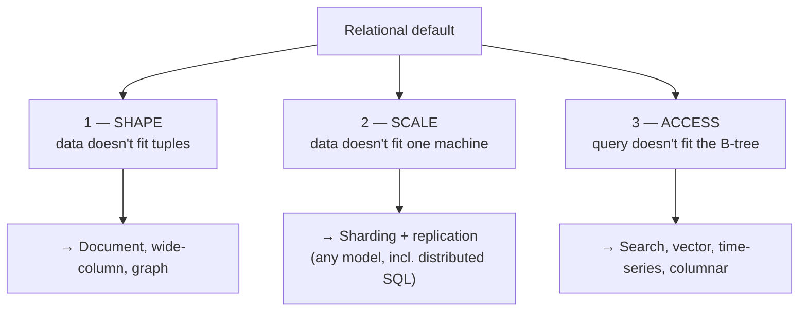
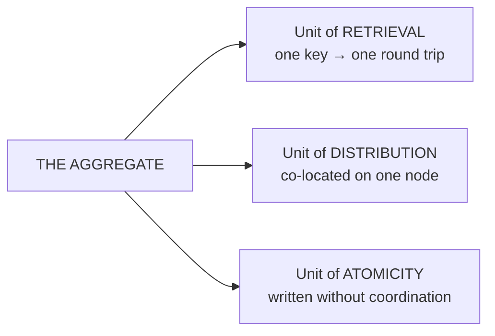
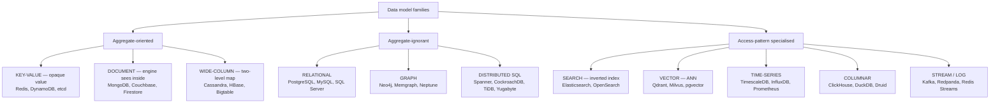
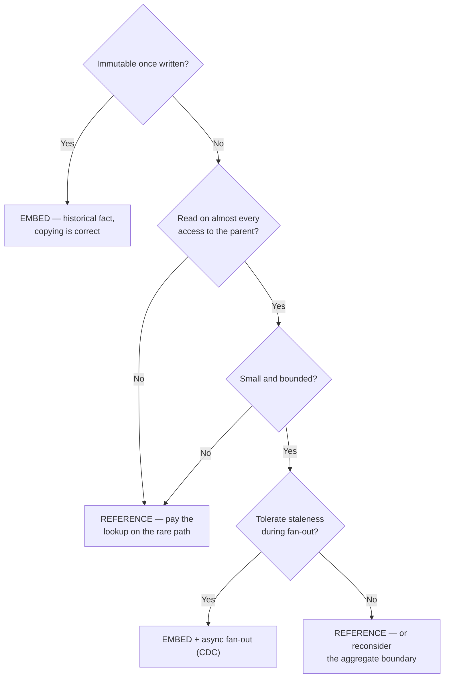
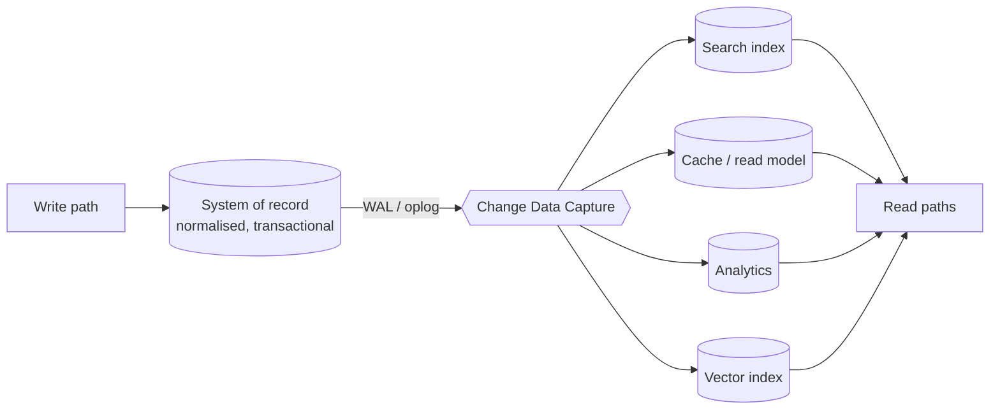
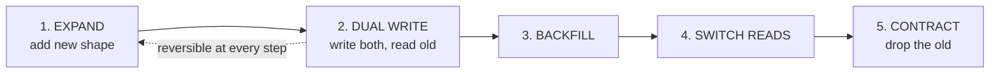
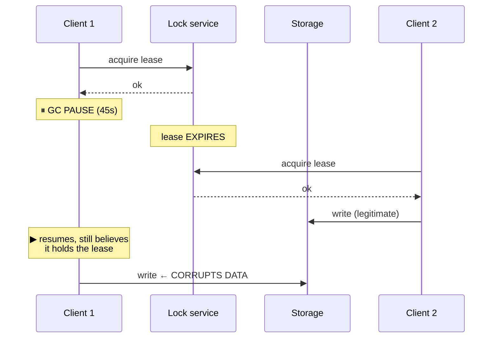
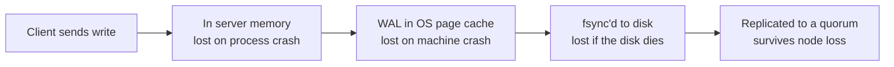
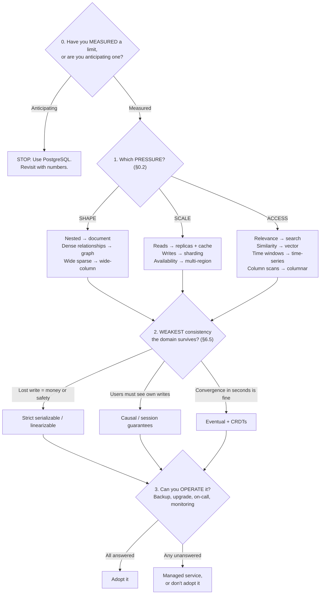

# From Relational to Non-Relational

### An introduction to the NoSQL landscape

**Purpose.** This is the shared vocabulary for the series. Before we touch Redis, MongoDB, Cassandra, or Neo4j, we need the concepts — because every engine we look at afterwards is just a specific set of answers to the questions raised here.

Organised by **concept**, not by product. Each idea is stated once, with the trade it implies.

| Part | Question it answers |
|---|---|
| 0 — The shift | What actually changed, and why "NoSQL" is a bad name |
| 1 — Measuring | What does "better" mean, and how do you measure it? |
| 2 — Data modelling | How is data shaped, and who decides the shape? |
| 3 — Schema | Where is structure enforced? |
| 4 — Distribution | How does data spread across machines? |
| 5 — Distributed trouble | Why is any of this hard? |
| 6 — Consistency | What does the system promise when things go wrong? |
| 7 — Storage mechanics | Why is this engine fast at *that* and slow at *this*? |
| 8 — Processing | How do you compute over data you can't fit in one place? |
| 9 — Choosing | Given all of the above, how do you decide? |

**Sources.** Sadalage & Fowler, *NoSQL Distilled* (aggregates, distribution models, consistency framing). Kleppmann, *Designing Data-Intensive Applications* (measurement, distributed failure modes, encoding, storage engines, batch/stream). Plus current practice where the field has moved on.

---

## Part 0 — The paradigm shift

### 0.1 What relational assumes

Relational won because it delivered four things: **structured access** to a slice of a large dataset, **concurrency control** via transactions, **integration** of many apps over one dataset, and a **near-standard model** that ports across vendors and decades.

Those rest on five assumptions:

- **Values are scalar** — a tuple holds atomic values, no nesting, no lists.
- **Records are uniform** — every row has the same columns.
- **Relationships are foreign keys, resolved at read time** — you pay for the join when you query.
- **The dataset lives in one failure domain** — correctness is defined over one logical machine.
- **Coordination is worth its latency** — better slow and right than fast and wrong.

Every one is a *choice*. **Every non-relational database relaxes one or more of them and pays for it somewhere else.** That is the whole paradigm shift.

### 0.2 Three independent pressures

They are genuinely independent, and the most common architectural mistake is treating all three as one pressure called "we need NoSQL." A team with 40 GB and a nesting problem doesn't need a cluster. A team with a real write-throughput problem and rectangular data doesn't need to abandon SQL. **Diagnose the pressure before choosing the tool.**

### 0.3 The conservation law

**A database does not eliminate complexity. It relocates it.** Every guarantee the engine stops enforcing becomes something your application must enforce, or something you agree to live without.

| Assumption relaxed | You gain | You now own |
|---|---|---|
| Scalar values → nested aggregates | One read fetches everything | Duplicated data, update fan-out, size limits |
| Uniform records → flexible records | No migration to add a field | Every reader handles every historical shape |
| Read-time joins → write-time denormalisation | Fast, predictable reads | Keeping copies in sync |
| Engine schema → application schema | Ingest anything, decide later | Bad data lands silently; wrong answers, not errors |
| Single failure domain → cluster | Scale, availability | Partitions, conflicts, clock skew, split brain |
| Coordination → local acknowledgement | Low latency, high availability | Stale reads, lost updates, conflict resolution |
| Ad-hoc query → fixed access paths | Predictable performance at scale | New questions need new tables |
| ACID → single-unit atomicity | No distributed locking | Sagas, compensations, idempotency, outbox |

"Should we use X?" is really: **would you rather own the left column's problems or the right column's?**

### 0.4 This has happened before

Before relational, IBM's **IMS** used a *hierarchical* model — nested record trees. Good at one-to-many, bad at many-to-many: exactly the profile of a modern document store. The **network model** (CODASYL) let a record have multiple parents but made the programmer traverse access paths manually. Relational won on one issue: **many-to-many relationships and querying without pre-planning the traversal.**

The question that decided it in 1975 decides it now: **how many-to-many is your data?**

### 0.5 On the name

"NoSQL" was a meetup hashtag in 2009. Retire it in technical conversation:

- **SQL isn't the issue.** CQL, N1QL, and Spanner's dialect are all SQL-shaped.
- **Relational absorbed the features.** Postgres does binary JSON with GIN indexing, vectors, geospatial, full-text, time-series.
- **It groups unrelated things.** Redis and Neo4j share exactly one property: neither is relational. That's a complement set, not a category.

**Say what you mean:** document store, wide-column store, key-value store, graph, vector, distributed SQL.

---

## Part 1 — Measuring data systems

### 1.1 Reliability

A **fault** is one component deviating from spec. A **failure** is the system stopping delivering service. Faults are inevitable; failures are what you prevent. That's why deliberately injecting faults is engineering, not vandalism — you cannot claim tolerance you have never exercised.

| Class | Characteristic |
|---|---|
| **Hardware** | Random and independent; redundancy handles it well |
| **Software** | **Correlated** — the same bug hits every node at once, so redundancy doesn't help |
| **Human** | The **leading cause** of outages in practice |

### 1.2 Scalability

Not a property a system *has* — it's *"if load grows in a particular way, what are our options?"* Naming the **load parameter** is most of the work: requests/sec, **read:write ratio**, concurrent sessions, cache hit rate, **fan-out**.

Fan-out is the subtle one. A social feed can be built at read time (cheap writes, expensive reads) or by pushing each post into every follower's timeline at write time (cheap reads, expensive writes). A user with 30 million followers makes write-time fan-out pathological. **The right load parameter isn't "posts per second," it's the distribution of followers per user.** Averages hide the whole problem.

### 1.3 Percentiles and the tail

**Do not use averages.** Use p50 (typical experience), p95, p99, p999.

Two consequences:

**The slowest requests belong to your most valuable users** — the ones with the most data, history, and orders. Optimising the mean ignores exactly the people you can't afford to lose.

**Tail latency amplification.** If one user request fans out to 10 backend calls and each is p99-slow 1% of the time, ~10% of *user* requests hit at least one slow call. **A 1% backend problem is a 10% user problem.** Any scatter/gather pattern amplifies the tail — which is a quantitative argument for designing reads that hit **one partition**.

*Measurement note:* aggregate percentiles from histograms (HDR, t-digest). Averaging p99s from several machines is meaningless.

### 1.4 Maintainability

Most of a system's cost comes after it ships. **Operability** (can the team run it?), **simplicity** (controlling *accidental* complexity), **evolvability** (can it be changed safely?). Worth naming because **operability is usually the deciding factor between two technically adequate options** — and the factor most often left out of the comparison.

---

## Part 2 — Data modelling

### 2.1 Data model vs storage model

The **data model** is how you perceive data (tables, documents, nodes and edges). The **storage model** is how bytes sit on disk (B-tree pages, LSM SSTables, columnar row groups). In principle you can ignore the storage model; in practice performance leaks through it. Part 7 exists because of that leak.

### 2.2 Declarative vs imperative queries

**Imperative** says *how* — loop, test, append. **Declarative** says *what* — `WHERE status = 'shipped'`. SQL, Cypher, and MongoDB's aggregation pipeline are declarative; hand-written map-reduce and app-side filtering are imperative.

**A declarative query hides the execution strategy, so the engine is free to change it** — pick a different index, reorder joins, parallelise across cores and machines. **Every time you drop to imperative code, you take the optimiser out of the loop.**

### 2.3 Normalisation and its inverse

**Normalisation** stores every fact once — a fact stored once cannot become inconsistent with itself. **Denormalisation** stores facts more than once, trading consistency risk for read performance.

Relational treats denormalisation as a last resort. Aggregate-oriented databases invert this: **denormalisation is the default.** The reason: a join is a runtime operation whose cost may involve another machine — or may not exist as an operator at all. If you can't afford it, you pre-join at write time. That pre-joined artifact is the aggregate.

**A distinction that prevents confusion:** copying a *product name* into 10,000 order lines is denormalisation with a maintenance obligation. Copying the *shipping address* into a shipped order is a **snapshot of a historical fact** — it must *not* stay in sync. That's correct modelling, not a violation.

### 2.4 The aggregate

**The single most important concept in non-relational modelling.** An **aggregate** is a cluster of data treated as one unit — retrieved together, written together, made consistent together.

Those three are the same property from three angles. Because the engine knows this data belongs together, it can put it in one place; because it's in one place, it can be written atomically. **This is the mechanism by which non-relational databases run on clusters** — the aggregate tells the engine what to keep together, and relational has no way to express that.

**The boundary is determined by access pattern, not by the domain.** Is the order the aggregate (with a customer reference), or is the customer the aggregate (with orders nested)? The first makes "load one order" one read; the second makes "load full history" one read but every new order rewrites the whole customer.

**The classic production failure is an unbounded array inside an aggregate** — write latency climbs with history length and eventually you hit a ceiling (MongoDB caps a document at 16 MB). **The fix is bucketing:** `customer:1:orders:2026-Q1`. A little client-side assembly in exchange for a bounded aggregate — almost always the right trade.

**On transactions:** the claim that these databases "don't have transactions" is out of date. MongoDB has multi-document ACID (replica sets 4.0, sharded 4.2), DynamoDB has transactional APIs, distributed SQL sells cross-shard transactions as a headline. **But the design advice survives the feature** — cross-aggregate transactions cost coordination round-trips, locks held across the network, and new failure modes. Multi-aggregate atomicity is available; **designing so you rarely need it is still the point.**

### 2.5 Aggregate-oriented vs aggregate-ignorant

| | Aggregate-oriented | Aggregate-ignorant |
|---|---|---|
| Examples | Key-value, document, wide-column | Relational, graph |
| Distribution | Natural — the aggregate is the unit | Hard — no hint about what belongs together |
| Access **along** the grain | Very fast | Fast |
| Access **across** the grain | **Very slow** — touch every aggregate | Fast — that's what the planner is for |
| Best when | One access pattern dominates | Many patterns, none dominant |

The tell: *"Is there one obvious way this data gets read?"* If it depends who's asking — a PM, a fulfilment worker, a fraud analyst — aggregate boundaries help one and obstruct the rest. That's also why the same company runs both: the transactional path is aggregate-oriented, the analytical path isn't.

### 2.6 The model families

**Key-value vs document** — both store an aggregate under a key; the difference is **whether the engine can see inside**. Key-value gives total freedom of content and zero server-side query, so *every secondary access path is something you build and maintain by hand* — and the index is only as correct as your application code. Document stores index fields, query by content, and return fragments. Classify by behaviour, not architecture: **do you fetch by key, or ask questions about content?**

**Wide-column** is a two-level map, not a table: `partition key → { clustering key → { column → value } }`. The **partition key** is the unit of distribution; **clustering keys** set sort order within a partition, which makes in-partition range scans cheap. *Naming hazard:* "columnar" today usually means Parquet/ClickHouse-style analytical storage — say **wide-column** for the Bigtable lineage.

**Graph** — small records, dense interconnections. Graph databases move relationship navigation cost from **query time to insert time**: an edge is a pointer stored at both ends, so traversal is a dereference, not an index lookup. SQL joins compound per hop; a traversal is linear in edges actually walked. Worth knowing: **GQL is now an ISO standard** (ISO/IEC 39075:2024 — the first new ISO query language since SQL in 1987), and **SQL/PGQ** in SQL:2023 brings graph pattern matching into relational engines.

**The specialised families** exist because a specific access pattern is badly served by general-purpose indexes:

| Family | Access pattern | Core structure |
|---|---|---|
| Search | Rank documents by text relevance | Inverted index + BM25/TF-IDF |
| Vector | *k* nearest points in high-dim space | HNSW, IVF, product quantisation |
| Time-series | Aggregate a metric over a window | Time-partitioned, compressed, downsampled |
| Columnar | Scan 3 columns of 200 over a billion rows | Column storage + vectorised execution |
| Stream / log | Ordered, replayable event sequence | Append-only segmented log with offsets |

Vector search deserves a note: it is **approximate by design**. You tune a recall/latency knob. That's a different contract from every other index — a B-tree never returns "probably the right rows."

### 2.7 Query-first modelling

Relational habit: model the domain, normalise, then write queries against it. Aggregate-oriented habit is the reverse, and it feels wrong to relationally-trained people:

**Enumerate the queries first. Design the storage to answer them. New query → new structure.**

Cassandra makes this explicit — one table per query, denormalise on write, never join on read. The same order lives in `orders_by_customer` and `orders_by_status` as two separate tables.

**Gained:** every read is a single-partition lookup with predictable latency at any scale.
**Owed:** both tables are written on every change, and nothing enforces that they agree.

The characteristic failure mode: **a question nobody anticipated is not slow, it's impossible.** In relational, an unforeseen question costs a sequential scan; here it costs a migration.

### 2.8 Relationships between aggregates

Three options in increasing cost: **embed** (fast, correct for immutable snapshots, a burden for mutable facts), **reference** (correct, but no referential integrity, no cascade, no join — you get dangling references and find them in production), **duplicate into a purpose-built structure** (fast reads, two things to keep in sync).

**If most of your questions are about relationships rather than entities, that's the signal for a graph database** — not a document store with more references.

### 2.9 Derived data

A **materialized view** is a query result stored as data. Four maintenance strategies: **synchronous** (immediate, paid on the write path), **batch recompute** (minutes to hours, zero write cost), **incremental streaming** (sub-second, amortised off the write path — Flink, Materialize), **CDC fan-out** (sub-second — Debezium → Kafka → Elasticsearch/Redis/warehouse).

The pattern that generalises it is **CQRS**: writes go to one model optimised for correctness; reads are served from projections optimised per query, connected by a stream of changes.

**Why CDC rather than writing to both systems from the app:** the **dual-write problem**. If your code writes to Postgres then Elasticsearch and crashes in between, the two disagree permanently and no retry fixes it — you don't know which side succeeded. There is no atomic solution across two systems that don't share a transaction manager. CDC makes the database's own commit log the source of truth: one atomic write, everything downstream is a replay.

The **outbox pattern** is the same trick for events: write the business row and the event row in one local transaction, publish from the outbox.

**Rule: one system of record, many derived projections, never a dual write.**

### 2.10 Dimensional modelling

The analytical counterpart to aggregates. A **star schema** puts a large, narrow **fact table** at the centre — one row per event, immutable, append-only — surrounded by small **dimension tables** describing the who/what/where/when. A **snowflake schema** normalises dimensions further (more joins, generally less popular).

Why this shape: the fact table is append-only (suits columnar storage, compresses extraordinarily well), queries follow a uniform filter-then-aggregate pattern, and dimensions are small enough to **broadcast** to every node, making joins cheap.

**The contrast with aggregates is instructive.** An aggregate co-locates everything about *one entity* so a single read serves it. A star schema does the opposite — strips facts to keys and numbers so scanning *billions* is cheap, then pays a join for the descriptive attributes. Same data, opposite optimisation, because the access pattern is opposite. That's §2.5 expressed as a schema.

One recurring wrinkle: **slowly changing dimensions.** A customer moves from "SMB" to "Enterprise" — do historical orders show the old segment or the new one? Type 1 overwrites; Type 2 adds a row with validity dates. It's the snapshot-versus-reference question from §2.3 in analytical clothing.

---

## Part 3 — Schema

### 3.1 Schema-on-write vs schema-on-read

"Schemaless" describes an absence that doesn't exist. The real question is **where structure is enforced**.

| | Schema-on-write | Schema-on-read |
|---|---|---|
| Enforced by | The engine, at write | The consumer, at read |
| Bad data | Rejected at the door | Lands in storage, found downstream |
| Cost of change | Migration, paid once, up front | Zero at write; paid by **every reader, forever** |
| Failure mode | Loud — write errors, migration outage | **Silent — wrong answers, not exceptions** |
| Who pays | The producer | Every consumer, including future ones |
| Best when | Uniform, long-lived, many readers | Heterogeneous, exploratory, ingest-first |

Three things a serious treatment must add:

**It's a spectrum, and production lives in the middle.** MongoDB lets you opt *in* to schema-on-write per collection (`$jsonSchema` validators, with `warn` mode for rollout). Postgres lets you opt *in* to schema-on-read per column (`jsonb` + GIN index) and promote a field back out to a real column once it stabilises. **The mature pattern is a promotion pipeline:** new attributes arrive in the flexible zone, get observed, and graduate into enforced structure.

**Schema-on-read means the migration is lazy and permanent.** You deferred the work into every read path, indefinitely. Six shapes over three years means six branches in the parsing code — or more commonly five untested branches and one that works. **Always write an explicit version field** and dispatch on it; inferring shape from field presence breaks the first time a field is legitimately optional.

**The industry rebuilt schema-on-write for the data lake.** A decade of "land it raw, apply schema at read time" produced lakes nobody could safely query. **Iceberg, Delta Lake, and Hudi exist to put a governed, evolvable schema back on top of those files.** The lesson: **structure you don't enforce is structure you will eventually pay to reconstruct**, under time pressure, with incomplete information about what the old data meant.

### 3.2 The implicit schema

Any program that reads a field and expects a type *has* a schema. `order["qty"] + 1` asserts qty is a number, whether or not anything checks it. When the engine doesn't hold the schema, it lives in application code — so you learn the shape by reading code, the engine can't validate or optimise, and **multiple applications over one store will drift apart with nothing detecting it.** That last point is the strongest argument for putting a datastore behind one service with a versioned API.

### 3.3 Schema evolution

| Compatibility | Meaning | Enables |
|---|---|---|
| **Backward** | New code reads old data | Deploy readers first |
| **Forward** | Old code reads new data | Deploy writers first |
| **Full** | Both | Any order — the goal for shared data |
| **Breaking** | Neither | Coordinated stop-the-world |

Adding an **optional field with a default** is fully compatible. Adding a **required** field breaks old writers. **Dropping** breaks readers that require it (stop reading first, drop later). **Renaming** is a drop plus an add — dual-write both names through the transition. **Changing a type is the dangerous one**, because it can coerce instead of failing: `qty` from int to string produces string concatenation where you expected addition, and a dashboard that's confidently wrong.

**Expand / contract** is the only migration pattern that works without downtime:

### 3.4 Data contracts

Once data crosses a team boundary, informal schema stops working. **JSON** (no schema), **JSON Schema** (external, via validators), **Avro** (embedded/registry, compatibility checking built in — Kafka, data lakes), **Protobuf** (field numbers give strong guarantees — gRPC), **Parquet/ORC** (embedded, columnar), **Iceberg/Delta/Hudi** (table-level metadata).

A **schema registry** centralises schemas and *refuses* to register an incompatible version — turning "we broke the downstream consumer" from a production incident into a CI failure. That's the entire point of a data contract.

---

## Part 4 — Distribution

### 4.1 Vertical and horizontal — four different things

Two entirely separate axes. Conflating them causes real design errors.

| Term | What gets divided | Example |
|---|---|---|
| **Vertical scaling** | Nothing — the machine grows | `db.r6i.2xlarge → db.r6i.32xlarge` |
| **Horizontal scaling** | Nothing — you add machines | 3-node → 30-node Cassandra ring |
| **Vertical partitioning** | **Columns** | Move a 2 MB blob off the hot row; column families; Parquet column chunks |
| **Horizontal partitioning** | **Rows** | Shard by `customer_id`; Postgres partitioning by month |

**Vertical scaling is underrated.** A commodity server with 1–2 TB of RAM and NVMe moves where "you must shard" actually begins. Scaling up costs money; scaling out costs money *and* every concept in this part. A large fraction of systems that shard don't need to.

**Column families are vertical partitioning** — the wide-column model splits column-wise *inside* an aggregate so the engine reads the hot group without touching the rest.

### 4.2 Sharding

**Sharding** puts different rows on different nodes. It is the **only technique here that scales writes** — replication and caching scale reads. **Sharding alone reduces resilience:** more nodes means more failures, and each failure takes a slice of data offline. **Sharding must always be paired with replication.**

**Shard key selection** is the highest-leverage and hardest-to-reverse decision. A good key is **high cardinality**, **evenly distributed**, **present in your common queries** (otherwise every read scatters), and **stable** (changing it means physically moving the row). These conflict. Time gives beautiful range scans and terrible write distribution, because every write goes to today's shard — the **monotonic key hotspot**, the most common sharding failure there is.

| Strategy | Range scans | Rebalance cost | Used by |
|---|---|---|---|
| **Modulo hash** `hash(key) % N` | No | **Catastrophic** — nearly every key moves | Naïve implementations |
| **Consistent hashing + vnodes** | No | Only ~1/N of keys move | Cassandra, DynamoDB, Riak |
| **Fixed hash slots** (16,384) | No | Migrate slots, not keys | **Redis Cluster** |
| **Range partitioning** | **Yes** | Move one range | HBase, Bigtable, CockroachDB, TiDB |
| **Directory / lookup** | Depends | Cheapest, most flexible; adds a hop | Vitess, bespoke systems |

**Virtual nodes are the whole trick** in consistent hashing. With one token per node, load variance is severe and a failure dumps all recovery traffic on one neighbour. With 128–256 tokens per node, variance falls to single-digit percentages and recovery spreads cluster-wide.

Redis Cluster is the instructive counter-example: no ring, 16,384 fixed slots via `CRC16(key) mod 16384`, fully inspectable with `CLUSTER SLOTS`. **Hash tags** — `{user:1}:profile` and `{user:1}:cart` hash only on the braced part — are how you force co-location. **That is the aggregate boundary written into the key.**

**Hotspots.** Even distribution of *keys* ≠ even distribution of *traffic*. One celebrity user, one viral product, one bot. Mitigations: **key salting** (reads must fan out and merge), **write sharding**, **caching in front**, **adaptive rebalancing**. The important distinction: **virtual nodes fix structural imbalance; they do nothing for workload imbalance.** Different problems, different fixes.

**Resharding.** Moving data consumes exactly the resources the cluster is already short of. **Shard while you still have headroom** — rebalancing is a background task on a healthy cluster and an outage on a busy one.

### 4.3 Replication

Replication copies the same data to multiple nodes. It buys read throughput, availability, and durability. It costs consistency — every topology is a different answer to *"what happens when two copies disagree?"*

**Single-leader.** One node accepts writes; others copy and may serve reads. **No write-write conflicts are possible** — a single node imposes a total order. Costs: writes don't scale past one node, leader failure means no writes until a new leader exists, follower reads are stale by the replication lag. *Note:* read resilience requires separate read and write paths in your application, and you don't have it until you've tested with writes disabled.

**Multi-leader.** Several nodes accept writes, typically one per region, replicating asynchronously. Local writes are fast; each region survives losing the others. The cost is **write-write conflicts between leaders**, now guaranteed rather than possible.

**Leaderless.** Every replica accepts writes; the client writes to several and reads from several, with anti-entropy and read repair in the background. No single point of failure, no write bottleneck, no failover pause — the Dynamo design. Conflicts become a normal operating condition and consistency becomes a per-request quorum calculation.

**What actually gets replicated** matters, because it's what CDC reads:

| Format | Problem |
|---|---|
| **Statement-based** | Non-deterministic functions (`NOW()`, `RAND()`) diverge |
| **WAL shipping** | Coupled to storage engine and version — blocks rolling upgrades |
| **Logical / row-based** | Slightly larger; **this is the one you want** |
| **Trigger-based** | Flexible, but slow and bug-prone |

**Logical replication is what makes CDC possible** — decoupled from the storage engine, so Debezium can parse the Postgres WAL, MySQL binlog, MongoDB oplog. One mechanism, two uses.

| | Single-leader | Multi-leader | Leaderless |
|---|---|---|---|
| Write-write conflicts | Impossible | Expected | Expected |
| Write scaling | No | Per region | Yes |
| Under partition | Minority stops | Both sides continue | Continues |
| Failover pause | Yes — election | No | No |
| Complexity | Low | High | High |
| Examples | Postgres, MySQL, MongoDB, Redis | CouchDB, Redis CRDB | Cassandra, DynamoDB, Riak |

### 4.4 Consensus and failover

When a leader dies, something must guarantee **two nodes never both believe they are leader**. Two nodes accepting writes for the same data is **split brain**, and it produces divergence no later reconciliation fully repairs. Since 2014 the answer has overwhelmingly been **Raft**.

The majority requirement is what makes split brain impossible: two leaders would each need a majority of the same set, and two majorities must overlap. **This is the same overlap argument as read/write quorums (§6.8)** — one idea appearing twice.

- A group of **3 tolerates 1 failure**; **5 tolerates 2**. Even-sized groups buy nothing.
- A minority partition **cannot make progress, by design**. Not a bug.
- Raft or Paxos underpins CockroachDB, TiKV, YugabyteDB, etcd, Consul, Spanner. MongoDB elections are Raft-derived.

**Redis takes a different route** — Sentinel, and gossip plus node voting in Cluster mode. It is *not* a replicated consensus log, and that explains both its failover semantics and its durability envelope.

### 4.5 Combining sharding and replication

Production topology is both: each shard has its own leader, and leaders are spread so no machine is idle and none is a single point of failure for everything.

**Replication factor 3** remains the near-universal default — survives one failure while retaining a quorum. Modern deployments spread those three across **availability zones** rather than racks.

**Geo-distribution adds a policy dimension.** GDPR, financial localisation, and healthcare sovereignty made *where a row physically lives* a declarative property — CockroachDB `REGIONAL BY ROW`, Yugabyte tablespaces, Spanner placement policies. **Data residency is now a schema concern.**

### 4.6 Disaggregated storage and compute

Aurora, Neon, AlloyDB and the serverless generation split the database into a **stateless compute tier** and a **replicated storage service**. Consequences:

- **Failover doesn't promote a replica** — it attaches new compute to durable storage
- **Read replicas don't copy data** — they read the same storage, so lag is much smaller
- **Scale-to-zero** becomes possible, because compute is disposable
- **Branching becomes cheap**, because storage is copy-on-write

### 4.7 Request routing

Once data is partitioned, somebody has to know the map. Exactly three places to put it:

| Approach | Extra hop | Client complexity | Examples |
|---|---|---|---|
| **Any node forwards** | Sometimes | None | Cassandra, Redis Cluster (`MOVED`) |
| **Routing tier** | Always | None | MongoDB `mongos`, Vitess `vtgate`, HBase |
| **Partition-aware client** | Never | High — client tracks the map | Kafka producers, Redis cluster clients |

All three need the map to stay current as partitions move — itself a consensus problem, hence ZooKeeper and etcd sitting behind many of these systems.

Redis Cluster is the clearest teaching example because it exposes the mechanism: send a command to the wrong node and you get `(error) MOVED 5798 127.0.0.1:7002` — a redirect, not an error. A naive client follows it and pays two round trips; a smart client caches the slot map.

---

## Part 5 — The trouble with distributed systems

Part 4 said how to spread data. This part says why it's hard — and it's the motivation for Part 6. Skip it and consistency models look like academic hair-splitting; read it and they look like the minimum necessary response to a hostile environment.

**The premise:** on one machine a fault is usually total and honest — the process crashes and you know it. In a distributed system you get **partial failure**: some parts work, some don't, and *you cannot reliably tell which.*

### 5.1 The network is unreliable, and silence is ambiguous

A request can fail at six points and **the caller cannot distinguish them**: request lost, request delayed, node crashed before processing, node paused mid-processing, response lost, response delayed. All the caller observes is *no response*.

**A timeout is not information about what happened; it's the absence of information.** Every retry is therefore a possible duplicate — which is why idempotency (§6.11) is mandatory rather than good hygiene.

**Choosing a timeout is a genuine dilemma.** Too short and you declare healthy-but-slow nodes dead, triggering failovers and duplicated work — which adds load, which makes more nodes slow: a cascading failure. Too long and users wait through outages you already know about. Most networks are **asynchronous with unbounded delay**, so no timeout is provably correct. Adaptive timeouts (phi accrual failure detectors) beat fixed ones but don't dissolve the problem.

### 5.2 Clocks lie

| | Time-of-day clock | Monotonic clock |
|---|---|---|
| Synced by | NTP — **can jump forwards or backwards** | Never adjusted |
| Comparable across machines | Nominally — but see below | **No** |
| Correct use | Timestamps for humans, TTLs, logs | **Measuring durations and timeouts** |

**Rule: measure elapsed time with a monotonic clock; use wall-clock only when a human needs to read it.** NTP can step a clock backwards, leap seconds have crashed production systems, a VM's clock pauses when descheduled, and a firewalled node drifts silently.

This is the mechanism behind the **Last-Write-Wins hazard**: a node 30 seconds fast wins every conflict for 30 seconds, including against writes that genuinely happened later — with no error. It's also why **Hybrid Logical Clocks** exist. **Clock skew must be monitored as a first-class alert.**

### 5.3 Processes pause

A thread can stop for an arbitrarily long time with no warning: **stop-the-world GC**, **VM suspension or live migration**, **OS descheduling**, **blocking disk I/O**, **SIGSTOP**.

Code that reads a variable, checks a condition, and acts can be paused between the check and the act. When it resumes, the world has changed and it doesn't know. **There is no `assert(I have not been paused)`.**

### 5.4 Fencing tokens

The nasty consequence for anything using locks or leases — including every distributed lock on Redis, ZooKeeper, or etcd:

Client 1 isn't malicious or buggy — it simply lost time. **The fix is fencing:** every lease grant returns a strictly increasing **fencing token**, every write carries it, and the resource **rejects any token lower than the highest it has seen**.

Two lessons:

- **A distributed lock without fencing is not a lock — it's a hint.** This is the substance of the Redlock debate: the safety argument depends on timing assumptions §5.2 and §5.3 say you cannot make.
- **Don't ask nodes to be honest about themselves — make the resource check.** A node cannot detect its own pause, so the guarantee must live at the point of effect. Same shape as optimistic concurrency: don't trust that nothing changed, *verify at the write*.

### 5.5 Truth is defined by the majority

**A node's own opinion about its status is worthless.** A node declared dead by a majority *is* dead for the system's purposes, regardless of whether it's still running. This is why consensus requires a majority, why two leaders can't both be legitimate, and why quorum reads and writes use the same overlap argument.

**One idea, three appearances:** Raft majorities, `R + W > N`, and "truth is defined by the majority" are the same theorem in different clothes.

### 5.6 System models

A guarantee is only correct *with respect to a model*.

**Timing:** **synchronous** (bounded delay, pauses, clock error — essentially never true), **partially synchronous** (behaves synchronously most of the time, with unbounded bad periods — the standard model), **asynchronous** (no timing assumptions — very safe, very limiting).

**Node failure:** **crash-stop**, **crash-recovery** (may return, losing memory but keeping disk), **Byzantine** (nodes may lie or be malicious).

Almost every database you'll use assumes **partially synchronous, crash-recovery**. Byzantine tolerance needs 3f+1 nodes to tolerate f malicious ones and is reserved for adversarial settings — blockchains, aerospace, mutually distrusting organisations.

**Safety vs liveness** is the last piece of vocabulary. **Safety** — "nothing bad happens"; once violated it's permanent, you can't un-corrupt data. **Liveness** — "something good eventually happens"; may be violated temporarily. Real systems require safety *always* and liveness only under favourable conditions. That's exactly the bargain a Raft minority partition strikes: it stops making progress (liveness) precisely so it cannot elect a second leader (safety). Framed that way, "the minority side stops" stops looking like a limitation.

---

## Part 6 — Consistency and correctness

"Consistency" is one word covering at least four unrelated things. Separating them is the most valuable thing this part does.

| Sense | Means |
|---|---|
| **The C in ACID** | Invariants hold — mostly the *application's* job |
| **The C in CAP** | Linearizability — a read sees the most recent completed write |
| **Logical consistency** | Related data items agree with each other |
| **Replication consistency** | Copies of the same item agree with each other |

A system can have any subset.

### 6.1 ACID, decomposed

| Letter | Who actually provides it |
|---|---|
| **Atomicity** | The engine |
| **Consistency** | **The application** — the engine only enforces declared constraints |
| **Isolation** | The engine, at a level *you choose* |
| **Durability** | The engine, to a degree *you configure* |

Two letters are widely misread. **"Consistency" in ACID is the odd one out** — not a property the database provides, but one your transactions must preserve. **Isolation and durability are dials, not booleans**; almost no production system runs serializable with synchronous durability everywhere. Knowing which anomalies you've accepted is the actual skill.

**BASE** (Basically Available, Soft state, Eventual consistency) is a weaker acronym with no rigorous definitions. Its one useful contribution: Brewer framed ACID and BASE as **ends of a spectrum, not a binary**. Keep the spectrum, drop the acronym.

### 6.2 The conflict taxonomy

**Write-write conflict (lost update).** Two clients read stock=5, one decides 5−2=3, the other 5−3=2, both write. Final = 2, but 5 units of demand were consumed. What makes it insidious: **neither write failed.** Both clients were told they succeeded.

**Read-write conflict (inconsistent read).** A reader lands between two writes that must agree — line items updated, total not yet. The duration of exposure is the **inconsistency window**. In an aggregate-oriented store you get logical consistency *inside* an aggregate for free, and not at all *between* aggregates.

**Replication inconsistency (stale read).** The same item read from two replicas returns two values. Given no further writes, replicas converge — that's **eventual consistency**. Replication *amplifies* the read-write conflict: two writes milliseconds apart on the leader can be seconds apart on a lagging follower.

### 6.3 Pessimistic and optimistic concurrency

| | Pessimistic | Optimistic |
|---|---|---|
| Strategy | **Prevent** the conflict | **Detect** the conflict |
| Mechanism | Locks | Version check at write |
| Uncontended cost | Lock overhead on everything | Nearly free |
| Contended cost | Waiting; **deadlock risk** | Retries; livelock risk |
| Good for | High contention, short transactions | Low contention, long think-time |

The general trade is **safety vs liveness**. Pessimistic approaches can degrade responsiveness badly and are where deadlocks come from; optimistic approaches require the application to handle rejection as normal control flow.

**MVCC** makes optimistic approaches practical at scale: rather than overwriting, the engine keeps multiple versions tagged by transaction. **Readers never block writers; writers never block readers.** Default in PostgreSQL, InnoDB, WiredTiger, and effectively every distributed SQL engine. The cost is old versions accumulating — Postgres calls reclamation `VACUUM`, and bloat from unvacuumed dead tuples is one of its most common operational problems.

### 6.4 Isolation levels vs consistency models — two axes

The most common conceptual error in the field. **Different axes, from different research traditions.**

| | Isolation levels | Consistency models |
|---|---|---|
| Tradition | Database transactions | Distributed systems |
| Scope | **Multiple objects**, whole transactions | A **single object**, single operations |
| Question | "Can this txn see that one's partial work?" | "Does my read reflect the latest write?" |
| Top of scale | Serializability | Linearizability |
| It's the | **I** in ACID | **C** in CAP |

They're independent. Postgres `SERIALIZABLE` gives **serializability without linearizability** (a consistent but slightly stale snapshot). Redis gives **linearizability per key without serializability**. **Strict serializability** is both — what Spanner's TrueTime buys.

| Level | Dirty read | Non-repeatable read | Phantom | Write skew |
|---|---|---|---|---|
| Read uncommitted | ✗ | ✗ | ✗ | ✗ |
| **Read committed** *(common default)* | ✓ | ✗ | ✗ | ✗ |
| Repeatable read | ✓ | ✓ | ✗ | ✗ |
| **Snapshot isolation** | ✓ | ✓ | ✓ | **✗** |
| Serializable | ✓ | ✓ | ✓ | ✓ |

**Write skew** is the one to know — the anomaly snapshot isolation *doesn't* catch. Two transactions read overlapping data, each checks an invariant, each writes a *different* row. No write conflict, both commit, invariant violated. The classic case: two doctors, a rule that one must be on call, both check "is someone else on call?", both see yes, both remove themselves. **If your invariant spans rows, snapshot isolation is not enough.**

**How serializability is actually achieved** — three implementation families:

| Technique | Strength | Weakness |
|---|---|---|
| **Actual serial execution** (one thread) | Trivially correct, no lock overhead | Capped by one core; transactions must be short |
| **Two-phase locking (2PL)** | Correct under any workload | Poor concurrency, **deadlocks** |
| **Serializable snapshot isolation (SSI)** | Readers never block writers | Aborts and retries; degrades under contention |

**Serial execution is what Redis does** — single-threaded command execution is why every command, `MULTI/EXEC` block, and Lua script is atomic without locking. It also explains why **a slow Lua script or `KEYS *` blocks the entire server**: the property that gives you free atomicity also gives you head-of-line blocking. §0.3's conservation law in a single design decision.

**SSI is the modern default** where serializability is offered (Postgres, CockroachDB, FoundationDB). It's why `ERROR 40001` exists and why your application must retry.

### 6.5 The consistency lattice

"Strong vs eventual" is a two-point summary of a hierarchy with ~15 members, running roughly: eventual → read-your-writes / monotonic reads → PRAM → **causal** → sequential → **linearizable** → strict serializable, with the isolation branch (read committed → repeatable read / snapshot isolation → **serializable**) meeting it only at the top.

Two structural facts:

**The two branches are the two axes from §6.4** — single-object consistency and multi-object isolation. They meet only in strict serializability.

**Causal consistency is the practical ceiling under partition.** Bailis's *Highly Available Transactions* work established that linearizability, sequential consistency, serializability, snapshot isolation, and repeatable read are all **unachievable** in a totally-available system. Causal, PRAM, and read-your-writes are achievable with *sticky* availability. So if your hard requirement is "keep serving during a partition," causal is the strongest thing you can ask for. **Not a preference — a proof.**

**The session guarantees** are what users actually notice:

| Guarantee | Without it, the user sees |
|---|---|
| **Read-your-writes** | Post a comment, refresh, it's gone |
| **Monotonic reads** | Refresh and see an *older* state than before |
| **Consistent prefix** | The reply appears above the message |
| **Monotonic writes** | Set A then B, B applies first |

**Read-your-writes is the one users report as a bug.** The inconsistency window is fine between users and intolerable with yourself. Two implementations: **sticky sessions** (pin to one node — simple, degrades load balancing, breaks on failover) and **version tokens** (client carries the highest version observed; any node must catch up before answering — MongoDB's `afterClusterTime`). The second survives load-balancer churn.

### 6.6 The CAP theorem

Brewer's conjecture (2000), formalised by Gilbert & Lynch (2002): you cannot have all of Consistency, Availability, Partition tolerance.

**What it actually says:** *Consistency* means **linearizability**, not the C in ACID. *Availability* means every request to a **non-failing** node returns a response — a crashed node is not a violation, which is not what engineers usually mean by "available." *Partition tolerance* means operating through a **split brain**.

**Where it misleads:**

- **"Pick two" is not a real menu.** You don't choose partition tolerance; the network chooses for you. The real statement is narrower: *when a partition occurs, you must choose between consistency and availability.*
- **"CA" is nearly meaningless for a cluster** — it would have to shut down on partition.
- **It's a dial, not a switch.**
- **It only describes behaviour during a partition** — which is rare. It says nothing about the other 99.9% of the time.

The field has moved on. Brewer walked back "pick two" in *CAP Twelve Years Later* (2012); Kleppmann's *A Critique of the CAP Theorem* (2015) and *Please Stop Calling Databases CP or AP* argue the definitions are ambiguous and the framing binary where reality is a spectrum. **Teach CAP as vocabulary and history — then use PACELC as the working tool.**

### 6.7 PACELC

PACELC (Abadi, 2010) fixes CAP's central omission by asking what happens the rest of the time:

**If there is a Partition (P), choose Availability or Consistency; Else (E), choose Latency or Consistency.**

**The insight:** the reason most systems chose eventual consistency was never mainly fear of partitions. It's that **synchronous replication adds latency users feel on every single request.** Consistency requires coordination; coordination requires communication; communication takes time — paid on a perfectly healthy network.

| System | PACELC |
|---|---|
| Cassandra, DynamoDB, Redis (async) | **PA/EL** — stay up, low latency, tunable per query |
| MongoDB, Spanner | **PC/EC** — leader/majority writes, pay the coordination latency |
| CockroachDB / TiDB / Yugabyte | **PC/EC** — Raft majority on every write |

**CAP tells you what breaks during a crisis. PACELC tells you what you pay every day. Design against PACELC.**

### 6.8 Quorums and tunable consistency

You don't need every replica to agree — just enough that the read set and write set **must overlap**.

- **N** = replication factor, **W** = nodes that must ack a write, **R** = nodes that must answer a read
- **W > N/2** — no two conflicting writes can both reach a majority
- **R + W > N** — the read set and write set must share at least one node

`N=3, W=2, R=2` is the usual balanced default. Note this is **the same overlap argument as Raft majorities** — one idea, two applications. Don't confuse cluster size with replication factor: 100 nodes with RF=3 is normal, because most of the distribution is sharding.

**Tunable in practice:** Cassandra `CONSISTENCY ONE|QUORUM|LOCAL_QUORUM|ALL`; DynamoDB `ConsistentRead` per call; MongoDB `readConcern`/`writeConcern`; Riak per-bucket `n_val/r/w`; CockroachDB none (serializable always, deliberately); Redis `WAIT` (best-effort replica ack, **not** a consensus commit).

`LOCAL_QUORUM` deserves a callout: in multi-datacentre Cassandra it means *a majority within my datacentre* — a materially different guarantee, and choosing wrong is a classic incident.

**Three caveats: `R + W > N` is necessary but not sufficient.**

- **Sloppy quorums** — under partition, Dynamo-style systems accept a write on any W *reachable* nodes, not the W *correct* ones. The write "succeeded" but not where your read will look.
- **Overlap detects, it doesn't resolve.** Seeing two values doesn't tell you which wins.
- **Read repair is eventual** — divergence found on read is fixed in the background.

### 6.9 Durability

Not binary either. Four independent points where an acknowledged write can still be lost:

Every database lets you pick a point, usually per-write — Redis `appendfsync no|everysec|always`, Postgres `synchronous_commit`, MongoDB `w:majority, j:true`, distributed SQL Raft commit.

**Replication durability** is the failure mode people don't anticipate: a leader acknowledges a write, dies before replicating, and a follower that never saw it is promoted. The client was told it succeeded. It did not survive. Not a bug — the async replication trade, stated honestly.

**Operational vocabulary:** **RPO** (how much data you can afford to lose, in time — async replication with 2s lag means RPO ≈ 2s) and **RTO** (how long you can afford to be down). These are business decisions that dictate technical configuration, not the reverse.

**"The database said OK" and "the write survived" are different claims.**

### 6.10 Conflict detection and resolution

Two questions in order: *are these versions concurrent or ordered?* and *if concurrent, which wins?*

**Version stamps** — a field that changes on every update. Read it, hold it, present it back on write; the write is rejected if it no longer matches. This is the **Optimistic Offline Lock**, and it's the same algorithm at four layers of the stack:

- Redis `WATCH/MULTI/EXEC` — `EXEC` returning nil is not an error, it's the detector firing
- HTTP `ETag` + `If-Match` → `412 Precondition Failed`
- MongoDB — guard the update on the `_rev` you read, `$inc` it
- Postgres MVCC — `ERROR 40001 serialization_failure`, catch and retry

**Four layers, one algorithm.** Recognising that turns optimistic concurrency from a term into a reflex.

Stamps can be **counters** (comparable, but need one generator), **UUIDs** (anyone can generate, not comparable), **content hashes** (deterministic, not comparable), or **timestamps** (comparable *if clocks are trustworthy* — see §5.2).

**Version vectors** — a single counter needs a single authority. With multi-leader or leaderless replication there isn't one. A version vector carries **one counter per replica**. Version X supersedes Y if every counter in X is ≥ Y's; if each has one greater, they are **concurrent** — a conflict.

*Terminology, because the literature is unforgiving:* a **Lamport clock** is a scalar giving partial order without concurrency detection; a **vector clock** has one entry per process, tracking causality between *events*; a **version vector** has one entry per replica, tracking causality between *replica states*. **Databases use version vectors.**

**Hybrid Logical Clocks** combine a physical component (tracking wall-clock within the skew bound) with a logical counter that breaks ties and preserves causality. Small, directly comparable, close enough to real time to be meaningful in logs, and **never violates causality even with skewed clocks** — now the default in CockroachDB, Yugabyte, and MongoDB cluster time. The alternative, if you own the hardware: **Spanner's TrueTime** *bounds* clock uncertainty with GPS and atomic clocks, then waits out the interval before committing. That wait is what buys external consistency at global scale.

**Ordering and total order broadcast** — the thread connecting all of this. **Causality gives a partial order**; two operations may be concurrent with no causal link, which is exactly what version vectors detect. **Linearizability gives a total order** — there is no such thing as concurrent. Between them sit **Lamport timestamps** (`counter, node_id`), giving a total order consistent with causality — cheap, but it orders operations *after the fact*, so it can't tell you at write time whether another node is concurrently doing something conflicting (which is what a uniqueness constraint needs). That leads to **total order broadcast**: deliver messages to every node in the same order, reliably.

**The important structural fact: total order broadcast, linearizable storage, and consensus are all equivalent.** Solve one and you've solved the others. That's why ZooKeeper and etcd exist — they implement consensus once, correctly, and expose it as leader election, locks with fencing tokens, service discovery, and configuration.

**Last-Write-Wins — a known footgun.** Cassandra resolves by cell timestamp: highest wins. Simple, cheap, and it **silently destroys data** under clock skew. No error, no conflict marker, no sibling to inspect — the losing write ceases to exist. Mitigations: discipline NTP, monitor drift as a first-class alert, and don't use LWW where a lost write is a business event.

**CRDTs — resolution, not just detection.** A **Conflict-free Replicated Data Type** has a merge operation that is **commutative, associative, and idempotent**. Given those three properties, replicas that have seen the same set of updates converge regardless of order, duplication, or delay — no coordination, no consensus, no human. The property is **strong eventual consistency**.

| CRDT | Use |
|---|---|
| **G-Counter / PN-Counter** | Monotonic counters; counters that decrease |
| **LWW-Register** | Single fields where losing a write is acceptable |
| **G-Set / OR-Set** | Append-only sets; shopping carts, tags, memberships |
| **RGA / Yjs / Automerge** | Collaborative text editing |

These ship in production — Riak DT, **Redis Enterprise active-active geo-distribution**, Akka distributed data, and most modern collaborative editors. **The honest trade:** merge semantics must be *chosen*, and some domains have no correct automatic merge. CRDTs move the work from runtime coordination to design-time modelling.

### 6.11 Transactions across boundaries

**Two-phase commit (2PC).** A coordinator asks every participant to *prepare*, then to *commit*. Real atomicity — and a blocking protocol with a single point of failure. Participants that answered "ready" cannot abort unilaterally, so a coordinator crash strands locks indefinitely. Used *within* a cluster; largely avoided across independent services.

**Sagas.** A sequence of local transactions, each with a **compensating transaction** that semantically undoes it. No locks across services. But **a saga is not atomic** — intermediate states are visible, and a refund is not a rollback; it's a second business event, with the original charge still in the ledger.

| | 2PC | Saga |
|---|---|---|
| Atomicity | Real | **No** — eventual, via compensation |
| Intermediate states visible | No | **Yes** |
| Locks across services | Yes | No |
| Coordinator failure | Participants block | Resume or compensate |
| Fits microservices | Poorly | Well |

Sagas come as **orchestration** (a central coordinator — easier to debug, better for branching) or **choreography** (each service reacts to events — no central brain, but the flow is emergent and hard to trace).

**Idempotency — the requirement underneath all of this.** Any retryable step must be safe to execute twice, because you cannot distinguish "the request failed" from "the response was lost." Retries are mandatory, therefore idempotency is mandatory. The standard mechanism is an **idempotency key**: the caller supplies a unique key, the service stores (key → result), and a repeat returns the stored result.

Combine with the **outbox pattern** and you have the standard toolkit: one local transaction writes the business change *and* the outgoing event; CDC publishes it; consumers dedupe by key. **No distributed transaction anywhere, and no dual write.**

### 6.12 Verification

Every claim above is something a vendor asserts. Two ways to find out whether it's true.

**Jepsen** runs a database under injected partitions, clock skew, and pauses, then checks the operation history against a formal consistency model. **Nearly every public report found real violations of documented guarantees**, most since fixed. The lesson is epistemological: **a documentation page states an intention; a Jepsen report states a measured result.** No public analysis isn't evidence of correctness — it's an absence of evidence.

**Your own fault injection.** Jepsen tests the database. Nobody tests *your configuration* except you. Kill leaders during writes, partition with `netem`, skew a clock, fill a disk. **A system whose failure behaviour you've never observed is a system whose failure behaviour you don't know.**

---

## Part 7 — Storage and access mechanics

Storage-engine choice explains most of the performance differences between databases with similar data models — and failure modes that look mysterious otherwise.

### 7.1 B-tree vs LSM-tree

**B-tree** updates in place: find the page (random read), modify it, write the whole page back (random write). **LSM-tree** appends: WAL + in-memory memtable → flush as an immutable sorted file (SSTable) → background **compaction** merges SSTables across levels.

| | B-tree | LSM-tree |
|---|---|---|
| Write path | Random, page-sized, in place | **Sequential append** |
| Write throughput | Moderate | **High and sustained** |
| Point read | **One lookup — predictable** | May check memtable + several SSTables |
| Range scan | **Excellent — contiguous** | Must merge across levels |
| Latency profile | **Predictable** | Spiky — compaction competes for I/O |
| Deletes | Remove from the page | **Tombstones** — a delete is a write |
| Used by | Postgres, InnoDB, WiredTiger | Cassandra, RocksDB, ScyllaDB, TiKV, Pebble |

**Two simpler structures worth knowing.** **Hash indexes** — an in-memory map from key to byte offset in an append-only file; extremely fast point lookups and the conceptual ancestor of the LSM memtable. Two hard limits: the key set must fit in memory, and **range queries are impossible** because hashing destroys ordering. That one sentence explains most of what a key-value store can and cannot do.

**In-memory databases** — the counter-intuitive part is *why* they're fast: not mainly because they skip disk (the page cache already caches hot data) but because they **avoid the encoding overhead of a disk-friendly format entirely**. A Redis sorted set is a live data structure, not a serialised representation of one — which is why Redis can offer priority queues, set intersections, and ranked ranges that a disk-oriented engine would find awkward. Durability then becomes an explicit, separate concern, which is exactly why Redis exposes it as a configurable ladder.

**The three amplifications** are the vocabulary for what a storage engine costs you: **write amplification** (bytes written ÷ bytes the app wrote — determines SSD wear), **read amplification** (pages read ÷ pages needed), **space amplification** (disk used ÷ logical size). The **RUM conjecture** formalises it: optimise two of Read, Update, Memory overhead and the third worsens. No engine wins all three.

Two mitigations you'll meet constantly: **Bloom filters** (probabilistic "is this key definitely *not* here?" with no false negatives — what makes LSM reads tolerable) and **compaction strategy** (*levelled* = tighter space, more write amplification; *size-tiered* = the reverse — picking wrong is a common production problem).

**Why this matters operationally.** **Compaction is why write-heavy LSM databases have latency spikes** — background merging competes with foreground traffic, and when ingest outruns compaction you get *write stalls*. **Tombstones are why deletes can make a Cassandra cluster slower** — the data isn't removed until compaction, and reads must scan past the markers. Delete-heavy LSM workloads are an anti-pattern.

### 7.2 Row-oriented vs column-oriented

An orthogonal axis: within a page, whole rows together or whole columns together?

| | Row-oriented | Column-oriented |
|---|---|---|
| Good at | Fetch/modify whole records | Aggregate a few columns over many rows |
| Workload | **OLTP** | **OLAP** |
| Compression | Modest — mixed types | **Excellent** — one type, run-length and dictionary encoding |
| Single-row write | Cheap | Expensive — touches every column file |
| Examples | Postgres, MySQL, MongoDB | ClickHouse, DuckDB, Parquet, Druid, Redshift |

This is **vertical partitioning taken to its logical end**. Compression is the underrated benefit: a column of 4 distinct status values compresses to almost nothing, and since analytical queries are I/O-bound, **compression *is* speed**.

### 7.3 Indexing

An index is **derived data maintained by the engine** — a second copy organised for a different access path. It buys read speed and costs write speed and disk.

**Primary/clustered** (the table itself, ordered by key), **secondary** (field → primary key), **composite** (order matters — only leading prefixes are usable), **covering** (contains every column a query needs, so the table is never touched), **partial/filtered**, **inverted** (term → documents, the basis of search), **vector** (HNSW/IVF).

**Local vs global secondary indexes** — this distinction only exists once data is sharded, and it's the one people miss:

- **Local** — each shard indexes only its own rows. Writes are cheap and atomic with the row; reads must **scatter to every shard and gather**, so latency = the slowest shard.
- **Global** — one index, itself sharded by the indexed field. Reads are targeted; writes must update a **remote** shard, usually asynchronously, so **the index is eventually consistent**.

The trade is unavoidable. DynamoDB exposes both explicitly (LSI and GSI), and **GSIs are eventually consistent** — you can write an item and not find it through the GSI microseconds later. That surprises people, and it's a direct consequence of this diagram.

### 7.4 Caching

The most common derived-data structure, with the hardest correctness problem.

| Pattern | Trade |
|---|---|
| **Cache-aside** | Simple, ubiquitous; stampede risk on miss |
| **Read-through** | Cleaner app code; cache must know the DB |
| **Write-through** | Always fresh; slower writes |
| **Write-behind** | Fast writes; **data loss window** |
| **Refresh-ahead** | Hides latency; wasted work on cold keys |

**Invalidation is the hard part.** TTL (simple, always somewhat stale), explicit invalidation on write (fresh, easy to miss a path), CDC-driven (correct, more infrastructure). TTL is the default for a reason — **it's the only one that's self-correcting when you get the logic wrong.**

**Eviction policies:** LRU; **LFU** (resists a single large scan flushing your working set); TTL-based; and **no eviction**, which returns errors instead of silently dropping data — the right choice when the cache is being used as a database.

**Two failure modes to name.** **Cache stampede** — a hot key expires and a thousand concurrent requests all miss and hit the database at once (fix: a lock so only one recomputes, or probabilistic early expiry). **Cache penetration** — repeated requests for keys that don't exist bypass the cache entirely (fix: cache the negative result, or a Bloom filter of existing keys).

### 7.5 Tiering and lifecycle

**Hot** in memory or NVMe, **warm** on cheaper block storage, **cold** in object storage, **frozen** in archival. Time-series and log systems automate this with retention and downsampling — per-second for a week, per-minute for a month, per-hour forever. **The retention policy *is* part of the schema**, and deciding it late is how storage bills surprise people.

---

## Part 8 — Processing

### 8.1 OLTP, OLAP, and the space between

| | OLTP | OLAP |
|---|---|---|
| Unit of work | Small transaction, few records | Query scanning many records |
| Rows / columns per query | 1s–100s / all columns | Millions–billions / a handful |
| Latency target | Milliseconds | Seconds to minutes |
| Storage | Row-oriented | Column-oriented |
| Aggregate orientation | Helps enormously | **Actively obstructs** |

That last row is the crux. The boundary that makes "load this order" one fast read makes "sum revenue by SKU" touch every aggregate in the system. **Not a flaw to be fixed — the trade you accepted in §2.4.** The standard resolution is to run both stores, connected by a pipeline.

**HTAP** promised one engine for both; in practice workload isolation is the problem — analytical scans and transactional latency targets compete for the same resources. What the industry built instead is **composed architectures** marketed as "zero-ETL," where the CDC pipeline is hidden rather than eliminated, converging at the *storage* layer via Iceberg and Delta. **The practical answer for the next several years remains two engines, one pipeline.**

### 8.2 Batch and stream

**Batch** — bounded input, process all of it, emit a complete result; reprocessing = rerun. **Stream** — unbounded input, process incrementally with state, emit continuously updated results; reprocessing = replay the log.

**How events get from producer to consumer** — two families with very different semantics, and choosing wrong is an expensive mistake:

| | Traditional broker | Partitioned log |
|---|---|---|
| Examples | RabbitMQ, ActiveMQ, SQS | **Kafka**, Redpanda, Kinesis, Redis Streams |
| After acknowledgement | Message is **deleted** | Message is **retained** |
| Ordering | Per-queue at best | **Guaranteed within a partition** |
| Replay | Impossible | **Trivial — reset the offset** |
| Consumer position | Broker tracks per-message acks | Consumer tracks one **offset** |
| Fits | Task queues, work dispatch | **Event streams, CDC, derived data** |

**The property that matters is replayability.** If messages disappear once consumed, you can never build a new derived view from history. If the log retains them, adding a consumer means starting at offset zero and rebuilding the whole projection. **That single difference is what makes the log the backbone of derived data** — a broker moves work; a log is a durable ordered record from which any number of views can be reconstructed.

Concepts that only exist in streaming:

- **Event time vs processing time** — when it *happened* vs when you *saw* it. Almost all streaming correctness bugs come from using the wrong one.
- **Windowing** — tumbling (fixed), sliding (overlapping), session (bounded by inactivity).
- **Watermarks** — the estimate that all events before time T have arrived. A guess with a deadline.
- **Late data** — drop it, or allow the window to be revised, which means downstream consumers must handle retractions.
- **Delivery semantics** — at-most-once, at-least-once, effectively-once. True exactly-once *delivery* is impossible across a network; what systems provide is exactly-once *processing* via idempotency and transactional state.

**Joining streams** is hard because "the other side" may not have arrived. **Stream–stream** (window join — needs state for both sides, bounded by time), **stream–table** (enrichment against a CDC-maintained local view), **table–table** (materialized view join).

The stream–table case makes a key connection explicit: **the "table" is itself a CDC stream folded into local state.** A table is the current state; a stream is the sequence of changes that produced it — the same information in two representations, convertible in both directions. That duality is the core idea behind Kafka Streams' KTables and Flink's dynamic tables.

A subtlety with real consequences: **stream joins are time-dependent and therefore non-deterministic.** Enriching an order with a customer segment gives a different answer depending on whether it ran before or after that segment changed. If you need determinism, join against the table *as of the event's timestamp* — the slowly-changing-dimension problem from §2.10, again.

### 8.3 Map-reduce and what survives it

The pattern that made cluster computation legible: **ship the computation to the data, not the data to the computation.** **Map** touches one record so it parallelises perfectly and runs where the data is. **Reduce** collapses all values for one key. **Shuffle** moves data between them and is the expensive step. **Combine** pre-reduces on the map side to shrink the shuffle — only possible if the reducer's output has the same shape as its input.

As a user-facing API it's largely retired (Hadoop MapReduce is legacy; MongoDB deprecated `mapReduce` in 5.0 for the aggregation pipeline). **But three ideas are permanent:**

**1. The shuffle is still the shuffle.** Spark's `reduceByKey` vs `groupByKey` is exactly the combinable-reducer question — the first pre-aggregates map-side, the second moves the entire dataset across the network. The most common Spark performance bug in existence.

**1b. The join algorithms are permanent too.**

| Algorithm | Use when |
|---|---|
| **Sort-merge join** (reduce-side) | Both sides large, no assumptions available |
| **Broadcast hash join** (map-side) | One side fits in memory — **the star-schema case** |
| **Partitioned hash join** (map-side) | Both sides already share a partitioning key — no shuffle |

The middle row is why star schemas are fast: dimensions are small enough to broadcast, so a fact scan joins without a shuffle at all. The bottom row is why co-partitioning matters. And the failure mode is **skew** — one join key with a disproportionate share sends everything to a single reducer, which straggles while the cluster idles. Same phenomenon as the hotspot in §4.2, same fixes.

**2. Aggregate composability is an algebra fact, not a framework fact.** **You cannot average two averages.** To compute an average over partitions you must carry `(sum, count)` through and divide at the very end. Formally, the aggregate must be an **algebraic monoid** — associative, with an identity.

| Aggregate | Composable? | Carry through |
|---|---|---|
| SUM, COUNT, MIN, MAX | Yes | The value |
| AVG | **No** | (sum, count) |
| STDDEV | **No** | (sum, sum_of_squares, count) |
| COUNT DISTINCT | **No** | A HyperLogLog sketch |
| MEDIAN, percentiles | **No** | A t-digest / HDR histogram |

The bottom three are why **probabilistic sketches** exist. HyperLogLog gives distinct counts in a few kilobytes with bounded error, and crucially **sketches merge** — making a non-composable aggregate composable. It's the same mergeable-sketch idea as aggregating percentiles in §1.3.

**3. It's the clearest teaching vehicle for data locality that exists.** The modern equivalent is a MongoDB aggregation pipeline or Spark job: `$match` first to filter, `$group` carrying the count, divide last, `$merge` to materialize.

### 8.4 Incremental view maintenance

Recomputing a view from scratch when 0.1% of the input changed is wasteful. **Incremental view maintenance** computes the *delta*. It turned out to be much bigger than an optimisation — it's the foundation of Materialize, RisingWave, Flink SQL's changelog semantics, and Kafka Streams' KTables.

**Why it's hard:** deltas are easy for sums and counts and hard for anything needing global information. `MAX` is trivially incremental for inserts and requires a rescan on deleting the current maximum. Joins require state for both sides. Same composability question as §8.3, different clothes.

### 8.5 Event sourcing and the log as source of truth

Instead of storing current state and mutating it, store the **immutable sequence of events** that produced it. Current state becomes a fold over the log — itself just another materialized view, alongside the search index, analytics rollups, a free audit trail, and **a view you haven't thought of yet**.

**Buys:** complete audit trail by construction, time travel, the ability to build *new* projections from full history rather than from when you started collecting, and debugging by replay.
**Costs:** the log grows forever (snapshots and compaction mitigate), current-state queries need a projection, and **events are immutable but your understanding of them isn't** — schema evolution on historical events is the hardest version of §3.3, because you cannot rewrite the past.

**The connection to draw: CDC turns any database into an event log.** You don't have to adopt event sourcing wholesale — the write-ahead log your database already keeps *is* an event log, and Debezium reads it.

---

## Part 9 — Choosing

### 9.1 The decision path

**Question 0 is the one people skip and the one that matters most.** A modern single server holds terabytes of RAM. **Distribute because you measured a ceiling, not because the architecture diagram looked better with three boxes.**

### 9.2 The polyglot persistence bill

Right tool for each job is correct, and not free. Each additional datastore costs a backup/restore runbook **that someone has actually tested**, an upgrade path and version-skew matrix, monitoring and an on-call engineer who knows its failure modes, an access-control and secrets model, and **cross-store consistency, which nobody sells you and everybody needs.**

That last one dominates. The moment an order lives in Postgres and its search index in Elasticsearch, you own a dual-write problem — and dual writes have no atomic solution.

**The mature formulation: one system of record. Derived stores for the access patterns it serves badly. CDC between them. Never a dual write.**

That's also why "just use Postgres" is a defensible 2026 architecture: it serves relational, document, full-text, geospatial, time-series, and vector patterns adequately, and **one adequate store you operate well beats four excellent ones you operate badly.** Add a specialised store when you can name the access pattern Postgres serves badly *and* you've measured that it matters.

### 9.3 Where the series goes next

Everything above is abstract until you can watch it happen. Redis is an unusually good first engine because it spans nearly the whole concept map in one system, with commands you can inspect directly:

| Concept | Redis realisation |
|---|---|
| Aggregate | The value under a key — Hash, List, Set, ZSet, Stream, JSON |
| Key-value opacity | No `WHERE`; secondary indexes are Sets you maintain |
| Query-first modelling | The key naming convention *is* the schema |
| Schema enforcement | Entirely application-side — the purest schema-on-read there is |
| Sharding | 16,384 fixed hash slots; hash tags force co-location |
| Replication / failover | Async single-leader; Sentinel & gossip, deliberately **not** consensus |
| Isolation vs consistency | Linearizable per key, *not* serializable |
| Optimistic concurrency | `WATCH/MULTI/EXEC` is compare-and-set |
| Durability spectrum | `appendfsync` and `WAIT` expose the whole ladder |
| CRDTs | Active-active geo-distribution |
| Eviction and caching | `maxmemory-policy`: LRU, LFU, TTL, noeviction |
| Probabilistic sketches | HyperLogLog, Bloom, Cuckoo, t-digest as native types |
| Streams / vector search | Streams + consumer groups; vector sets / HNSW |

**Every abstract idea in this document has a concrete Redis command that makes it observable. That's the throughline for what follows.**

---

## Sources

**Books.** Sadalage & Fowler, *NoSQL Distilled* (2012) · Kleppmann, *Designing Data-Intensive Applications* · Petrov, *Database Internals* (2019) · Kimball & Ross, *The Data Warehouse Toolkit*

**Foundational papers.** Bigtable (OSDI 2006) · Dynamo (SOSP 2007) · MapReduce (OSDI 2004) · Gilbert & Lynch, *Brewer's Conjecture* (2002) · Spanner (OSDI 2012) · Shapiro et al., *CRDTs* (2011) · Ongaro & Ousterhout, *Raft* (2014) · Kulkarni et al., *Logical Physical Clocks* (2014) · Bailis et al., *Highly Available Transactions* (VLDB 2014) · Athanassoulis et al., *The RUM Conjecture* (2016) · Lamport, *Time, Clocks and the Ordering of Events* (1978) · Dean & Barroso, *The Tail at Scale* (2013)

**On CAP.** Brewer, *CAP Twelve Years Later* (IEEE Computer, 2012) · Abadi, *PACELC* — https://www.cs.umd.edu/~abadi/papers/abadi-pacelc.pdf · Kleppmann, *A Critique of the CAP Theorem* — https://arxiv.org/abs/1509.05393 · Kleppmann, *Please Stop Calling Databases CP or AP* — https://martin.kleppmann.com/2015/05/11/please-stop-calling-databases-cp-or-ap.html

**Consistency & verification.** Jepsen consistency map — https://jepsen.io/consistency/models · Kingsbury, *Strong Consistency Models* — https://aphyr.com/posts/313-strong-consistency-models · Kleppmann, *How to do distributed locking* — https://martin.kleppmann.com/2016/02/08/how-to-do-distributed-locking.html

**Storage & vendor docs.** TiKV, *B-Tree vs LSM-Tree* — https://tikv.org/deep-dive/key-value-engine/b-tree-vs-lsm/ · MongoDB multi-document ACID transactions · CockroachDB replication layer (Raft) · ISO/IEC 39075:2024 (GQL) — https://www.iso.org/standard/76120.html

*All diagrams are Mermaid and render on GitHub, GitLab, Obsidian, VS Code, MkDocs Material, and Docusaurus.*
